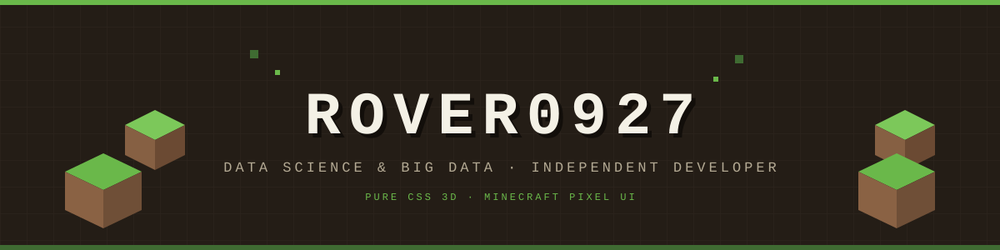
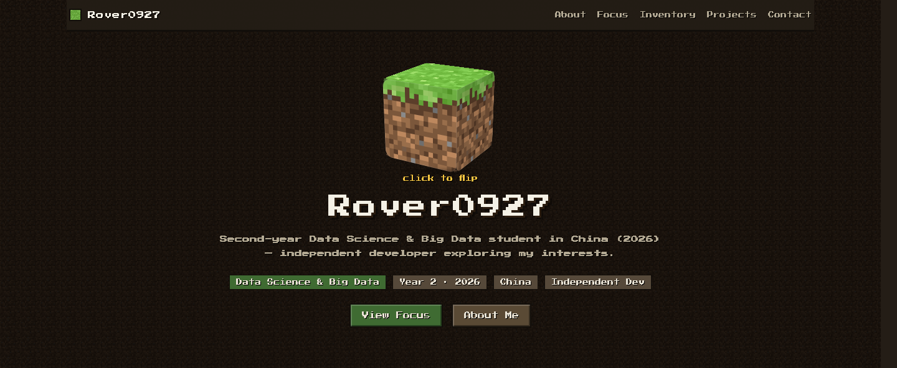
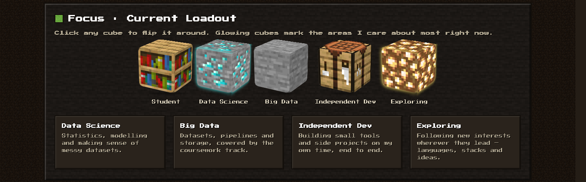
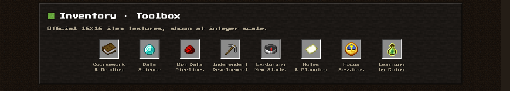
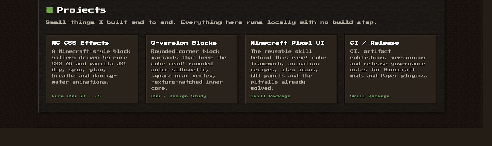

<picture>
  <source media="(prefers-color-scheme: dark)" srcset="./assets/banner-dark.svg">
  <source media="(prefers-color-scheme: light)" srcset="./assets/banner-light.svg">
  
</picture>

**Third-year Data Science & Big Data student in China (2026)**
*Independent developer exploring my interests.*

## 关于我 · About

<table>
  <tr>
    <td width="160" align="center" valign="top">
      
       
      <b>Rover0927</b>
    </td>
    <td valign="top">
      
I'm Rover0927, a third-year Data Science &amp; Big Data student in China. I learn by building: small pages, tools and experiments that I can finish end to end. Most of the projects below started as a question about how something works, then grew into a demo I could actually run.

      
我是 Rover0927，在中国读数据科学与大数据技术，目前大三（2026）。我的学习方式是自己动手做：能独立跑通的小页面、小工具和小实验。下面这些项目大多始于一个「这东西到底怎么实现」的疑问。

    </td>
  </tr>
</table>

## 个人主页 · Homepage

A Minecraft-style personal homepage built from scratch: six-faced cubes in pure CSS 3D, vanilla JS, no framework and no build step. Click any cube to flip it; glowing blocks mark what I'm focused on.

一个从零手写的 Minecraft 风格个人主页：纯 CSS 3D 六面立方体 + 原生 JS，没有框架、没有构建步骤。点击方块可以翻转，发光方块代表我当前的重点方向。

<table>
  <tr>
    <td width="50%"></td>
    <td width="50%"></td>
  </tr>
  <tr>
    <td align="center">Focus · 关注方向（点击翻转 / click to flip）</td>
    <td align="center">Inventory · 物品栏式技能展示</td>
  </tr>
</table>

- **纯 CSS 3D** — `perspective` + `preserve-3d` 搭出盒体，动画只改 `transform`
- **Q 版圆角** — 只磨外轮廓，近顶点保留直角，角缝由同贴图内芯补齐
- **官方素材** — 16×16 物品图标按整数倍放大，槽位复刻原版物品栏
- **可交互** — 点击翻转、发光 / 呼吸循环，移动端自适应

> 本地构建，尚未部署 · Built locally, not deployed yet.

## 项目 · Projects

| 项目 · Project | 说明 · What it is | 技术 · Stack |
| --- | --- | --- |
| **MC CSS Effects** | 方块展示页，含翻转、旋转、悬浮、发光、呼吸、水流等动画 A block gallery with flip, spin, hover, glow, breathe and flowing-water effects. | Pure CSS 3D · Vanilla JS |
| **Q-version Blocks** | 三种圆角方案对照，保留方块感的同时把棱角磨圆 Three rounded-corner variants that keep the cube readable. | CSS · Design Study |
| **Minecraft Pixel UI** | 技能包：立方体框架、动画配方、物品图标、GUI 面板与已踩过的坑 A reusable skill: cube framework, animation recipes, item icons, GUI panels and solved pitfalls. | Docs · Assets |
| **Minecraft CI / Release** | 面向 Minecraft 模组与 Paper 插件的 CI、产物发布、版本与发布治理规范 CI, artifact publishing, versioning and release governance for mods and Paper plugins. | CI · Release |

## 工具箱 · Toolbox

<table>
  <tr>
    <td align="center" width="12.5%"> Coursework &amp; Reading</td>
    <td align="center" width="12.5%"> Data Science Modelling</td>
    <td align="center" width="12.5%"> Big Data Pipelines</td>
    <td align="center" width="12.5%"> Independent Development</td>
    <td align="center" width="12.5%"> Exploring New Stacks</td>
    <td align="center" width="12.5%"> Notes &amp; Planning</td>
    <td align="center" width="12.5%"> Focus Sessions</td>
    <td align="center" width="12.5%"> Learning by Doing</td>
  </tr>
</table>

## 现在 · Currently

- 大三在读，数据科学与大数据技术 · Year 3, Data Science & Big Data (2026)
- 用纯 CSS 与原生 JS 做界面实验，尽量不引入依赖 · Building UI experiments with as few dependencies as possible
- 把重复出现的 Minecraft UI 工作沉淀成技能包 · Turning repeated Minecraft UI work into reusable skills
- 持续探索感兴趣的方向：数据、可视化、前端 · Exploring data, visualization and front-end

## 联系 · Contact

Built with pure CSS 3D blocks · 2026

